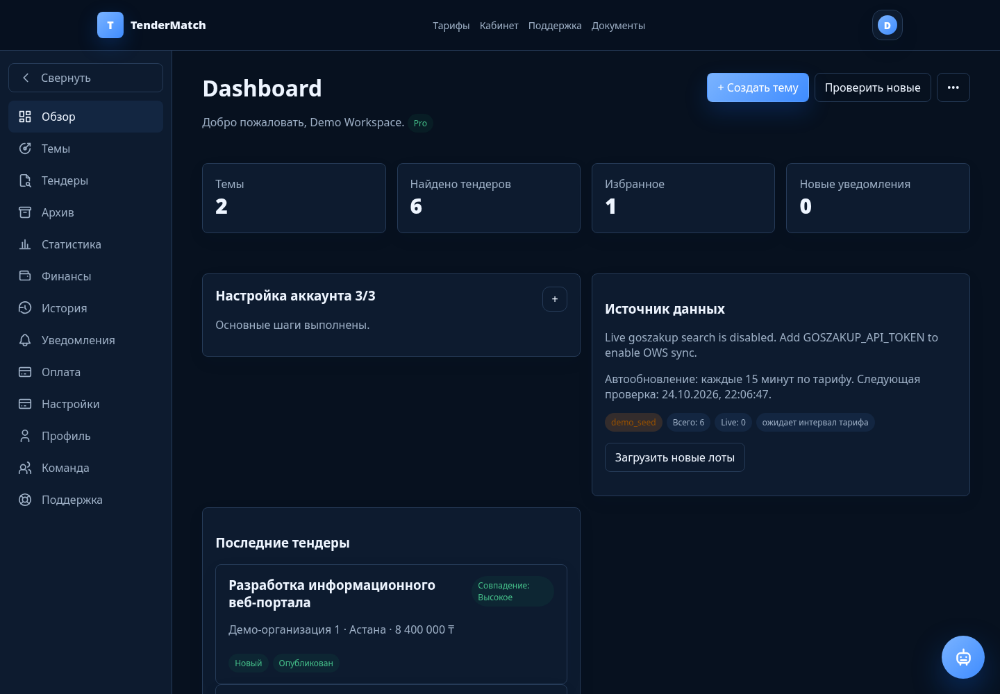
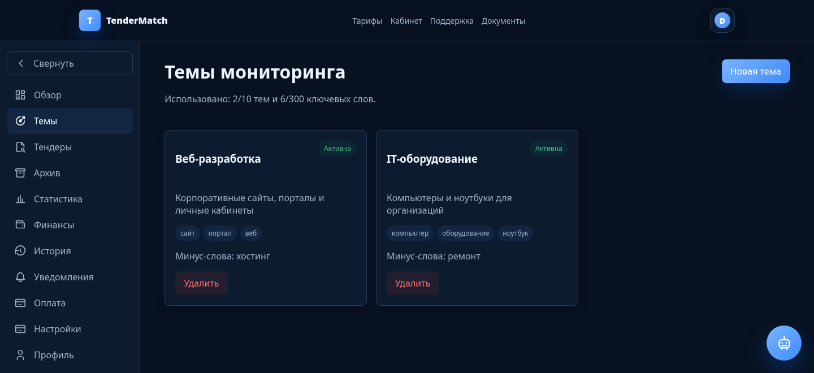
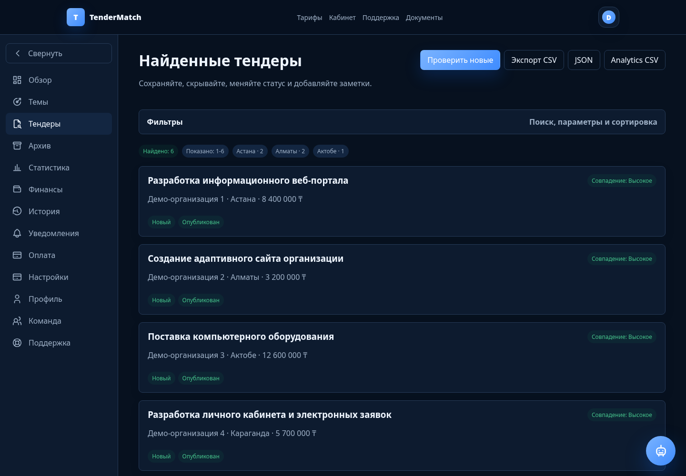
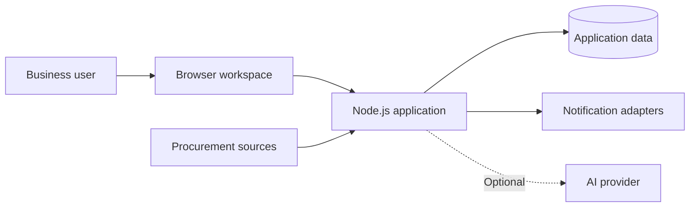

# TenderMatch

**A focused workspace for finding and evaluating public procurement opportunities in Kazakhstan.**

[Public website](https://tendermatch.kz) · [Developer](https://github.com/Patshkhan) · [Discuss a collaboration](https://github.com/Patshkhan/tendermatch-showcase/issues/new)

*The running application, captured locally with fictional organizations, amounts, and opportunities. These screenshots demonstrate the interface, not customer activity or business results.*

## The problem

Businesses looking for relevant tenders need to repeat searches, filter out unrelated purchases, track deadlines, and keep a shortlist organized. TenderMatch brings those tasks into one monitoring workspace: define what matters, review matches, and decide what deserves a closer look.

## What the product does

- **Monitoring topics:** keywords, excluded terms, region and amount filters.
- **Tender review:** a searchable list with relevance indicators, deadlines, favorites, statuses, and notes.
- **A working dashboard:** an overview of monitoring topics and discovered opportunities.
- **Notifications:** in-app updates, with email and Telegram integration code that requires configuration.
- **AI assistance:** an optional server-side integration for tender analysis and assistant requests, with quota and request-accounting code. It is disabled in the screenshot environment.
- **Account and subscription workflows:** authentication, email verification, plan limits, and a staged checkout flow.

Payment-provider activation and production acceptance are separate work. The current checkout implementation records unpaid orders; this showcase does not claim that live payments are enabled.

## Product walkthrough

### 1. Describe the work you want to find

Create a topic such as web development, add relevant terms, exclude hosting-only contracts, and set a budget range.

### 2. Review a shortlist

Open matching opportunities, compare their relevance, region, amount, and deadline. The examples below are deliberately fictional.

### 3. Keep decisions organized

Favorite a promising opportunity, record a note, and update its status. Return to the overview to see the current shortlist. Notifications and optional AI analysis support this workflow when their integrations are configured.

## Technology, confirmed in the project

| Layer | Implementation |
| --- | --- |
| Browser interface | JavaScript, HTML, CSS; a single-page interface without a frontend bundler |
| Application server | Node.js and its HTTP APIs |
| Persistence | PostgreSQL through `pg`; a separate local JSON store for demo fixtures |
| Email | Nodemailer and configurable SMTP |
| AI | Optional OpenRouter-compatible API integration on the server |
| Verification | Node.js test runner, PGlite integration tests, browser smoke checks |

## Architecture at a glance

This is a conceptual view. It intentionally omits server locations, credentials, internal endpoints, and database details. The local screenshot session uses synthetic JSON fixtures and makes no external API requests.

## My role

I develop TenderMatch across the product workflow, browser interface, backend, database integration, automated tests, and deployment preparation. The project gives me practical work in SaaS development, procurement search, and AI-assisted workflows.

## Current status

**Working MVP under active development.** The local interface is runnable, and the Node test command passed 61 tests during this portfolio preparation. This is evidence for that local snapshot, not production certification. External integrations, payment activation, and operational acceptance have their own remaining checks.

The [public website](https://tendermatch.kz) is the product's public entry point, not an unrestricted sandbox. This repository provides the safe demonstration; no demo login or customer access is published.

## About these materials

Screenshots were captured from the actual frontend on 24 October 2026, using a temporary local test account. Only the rendered user-facing screens and this documentation are published here. Application source, JavaScript bundles, databases, private configuration, and administrative screens remain outside this repository.

## Кратко по-русски

**TenderMatch** — SaaS-платформа для поиска и анализа тендеров Казахстана. Темы мониторинга, ключевые и минус-слова, фильтры, избранное и заметки помогают организовать работу с закупками. Здесь показан настоящий интерфейс с вымышленными данными; коммерческие исходники закрыты. Проект развивается как MVP, а готовность внешних интеграций и платежей проверяется отдельно.
